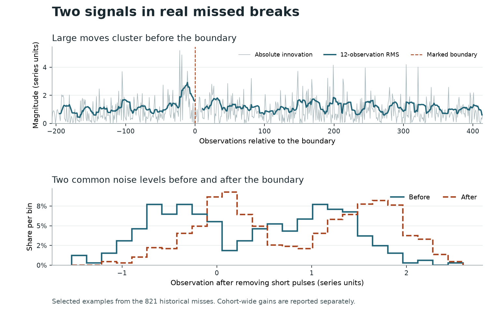

# What else changes when the average and variance look stable?

The strongest measured analogue to a phase shift is a change in **when large moves follow one another**. Two series can have similar overall spread while one has many large moves in succession. A second pattern is a change in **how often a series visits each of two common levels**. The project already uses both measurements.

## Volatility and the 821 historical misses

Claude trained two otherwise matched trees on the full series and two real crops, using the same seed and source-level folds. One received an additional block that compared volatility persistence, noise shape and changes in scale. The figures below compare the saved out-of-fold predictions on the same rows.

| Local ROC-AUC or count | Without volatility block | With volatility block |
| --- | ---: | ---: |
| All 24,000 series | 0.873302 | 0.874266 |
| 821 historical positives against all 12,000 negatives | 0.469041 | 0.477984 |
| Remaining 23,179 series | 0.902992 | 0.903370 |
| Misses recovered at 10% false positives | 17 | 23 |
| Misses recovered at 20% false positives | 69 | 78 |
| Misses recovered at 50% false positives | 376 | 373 |

For series `00025ef9b811b1466360f7abe81d5bf6`, the model-based probability of volatility clustering fell from 0.996 before the boundary to 0.034 afterward. The matched tree score rose from 0.1984 to 0.3995. In `993acd15135be1c02785aeb92c15c61f`, clustering increased from 0.034 to 0.997 and the score rose from 0.2589 to 0.5032. These are selected illustrations. The table measures the entire cohort. The experiment isolates the complete volatility block, so it cannot apportion the gain to any single feature. [Statistical model](../../pipeline/legacy_cpu/experiments/weight_space/white_volatility_law.py) · [Matched tree](../../pipeline/legacy_cpu/experiments/redesign/nested_crop.py) · [without](../tune_out/oof_MECH3C12_s0.npy) · [with](../tune_out/oof_MECH3C12V_s0.npy)

### Does clustering start or stop?

At each tree's own 20% false-positive cutoff, adding the volatility block newly caught 162 genuine breaks and dropped 145. Among the 1,464 historical misses the counts were 36 gained and 19 lost. Among the locked 821 white-noise-like misses they were **21 gained and 12 lost**, taking recovery from 69 to 78.

We split the existing model's evidence into the possibilities that clustering starts, stops, or changes while active on both sides. The calculation integrates over a common innovation distribution and overall scale, and reconstructs the original score. For each recovered break we matched a distinct no-break series at almost the same score after fitting the volatility block. The entries below are mean model probabilities conditional on allowing different volatility dynamics on the two sides. [Calculation](../../research/pipeline_dev/legacy_cpu/experiments/weight_space/white_memory_events.py) · [Matched comparisons before and after adding volatility](../tune_out/weight_space/memory_events_recovery.csv)

| Inferred event | 162 recovered positives | 162 matched negatives | 21 recovered historical white-like positives | 21 matched negatives |
| --- | ---: | ---: | ---: | ---: |
| Shock clustering starts | 16.5% | 10.1% | 30.3% | 6.4% |
| Shock clustering stops | 17.4% | 10.2% | 35.4% | 10.1% |
| Shock dynamics change while already active on both sides | 2.5% | 4.3% | 7.5% | 7.2% |

Both directions of the switch were more frequent in the model's account of the recoveries. The original tree used the same volatility evidence to select these cases, so the table explains its behavior. Giving the event probabilities another set of weights on top of the 0.878883 ensemble lowered overall AUC by 0.000024 on the primary split. [Distinct control matches](../tune_out/weight_space/memory_events_matches.json) · [Six-partition weight comparison](../tune_out/weight_space/signal_ablation_local_rank_opinion_linear_memory_events.json)

We then fixed a single measurement, the combined probability of onset or cessation, and removed all discovery cases and their matched controls. This left 776 separate historical miss–control pairs with similar original model scores, pre-boundary whiteness and segment lengths. The mean was 20.9% for the misses and 20.0% for controls. The paired difference was 0.9 percentage points with a 95% bootstrap interval of −1.3 to +3.2 points. The one-sided paired permutation probability was 0.216. The switch explains the selected recoveries, but this comparison found little separation in the broader group. [Replication](../tune_out/weight_space/memory_switch_replication.json) · [Matched observations](../tune_out/weight_space/memory_switch_replication_pairs.csv)

## Motion around two common levels

The oscillator result suggested a second question. If a predictable part of the series is removed, does a break become easier to see in what remains? For a series with two common levels, we fitted two peaks, estimated the probability of visiting each peak, and scored two views with the same project sequence models. One view follows the visits. The other subtracts the estimated level to expose smaller movements. The check requires two peaks within at least one side of the boundary. A simple jump between two single-peaked segments is insufficient. [Decomposition](../../pipeline/legacy_cpu/experiments/weight_space/white_remove_noise_modes.py) · [Sequence replay](../../pipeline/legacy_cpu/experiments/weight_space/white_channel_replay.py)

**38 of the 821** had strong evidence for two peaks under the pre-specified diagnostic cutoff, as did **1,033 of 12,000 negatives**. The presence of two levels alone is common in both groups. Allowing the score to depend on what changed around those levels improved overall AUC and AUC on the 821 on all six output-weight partitions on each of three parent models.

| Parent overall AUC | Change in overall AUC | Change on 821 | Change on remainder |
| ---: | ---: | ---: | ---: |
| 0.876485 | +0.000061 | +0.000476 | +0.000031 |
| 0.878079 | +0.000057 | +0.000787 | +0.000004 |
| 0.878182 | +0.000060 | +0.000848 | +0.000003 |

These are primary-split differences against each immediate parent. On the strongest parent the remainder changed by −0.000022 to +0.000016 across splits, with four small declines. At 20% false positives the strongest candidate recovers 85 versus 86 before the correction and 42 with the locked baseline. The score improvement reflects rankings across thresholds. [Five correction terms](../../pipeline/legacy_cpu/experiments/weight_space/white_reliable_signals.py) · [Six-split comparison](../../research/weight_candidates/wn_local_rank_early_mode_peaks_candidate/validation.json) · [Threshold counts](../../research/weight_candidates/wn_local_rank_early_mode_peaks_candidate/paired_audit.json)

The lower example is series `c6a9f3fd0afcab106271249f47702964`, selected for the largest standardized change in visits relative to the pooled centers among the 38 strong cases. Movement of the centers can also change that statistic. Relative to the immediate parent, these 38 gained 17,515 correctly ordered positive–negative pairs, or 461 negative ranks per missed break on average. The other 783 lost 9,157 pairs, or 12 each on average.

## Other signals tested

### Separating volatility memory from a hidden clock

Claude exported the signed contribution of each feature to two independently fitted source partitions of the same tree model. Matching historical misses and no-break series by pre-boundary whiteness, length and previous out-of-fold score left 817 historical misses and 9,654 controls with adequate overlap. Volatility contributed an average **0.0324 log odds more** to the matched misses, and the phase-model group contributed **0.0253 more**. The ordinary periodic and harmonic groups differed by less than 0.0005. These figures describe what the trees used. [Matched comparisons](../tune_out/weight_space/group_contrasts_matched.json)

The existing phase program fitted a wave for **13 of the 821** series. Four showed strong phase-change evidence, at periods of 15, 26, 27 and 30 observations. Its mixture score combines changes in level, amplitude, phase, scale and distribution shape. In a separate search over weak waves, no previously untested miss cleared the threshold for phase change in both withheld blocks. The same was true of the 6,020 previously untested white-looking negatives. [Existing phase model](../../pipeline/legacy_cpu/experiments/weight_space/phase_likelihood.py) · [Weaker-wave test](../../research/pipeline_dev/legacy_cpu/experiments/weight_space/white_weak_phase.py) · [Six-split evaluation](../tune_out/weight_space/signal_ablation_local_rank_early_mode_peaks_weak_phase.json)

Separately matching the **808 misses** outside the existing phase fit to **7,706 controls** isolated two contributions. The estimated persistence of large moves and pooled clustering contributed **+0.0075 log odds**. Evidence for a scale change while accounting for clustering contributed **+0.0096**. The named clock measurements contributed **−0.0002** in this group. The persistence parameters describe how quickly the effect of an earlier shock fades. [Named features and matched gaps](../tune_out/weight_space/named_signals_matched.csv) · [Volatility model](../../pipeline/legacy_cpu/experiments/weight_space/white_volatility_law.py)

Putting the families’ contributions into a recovery-focused score reached **0.510282 AUC on the 821**, **0.905349 on the remainder** and **0.878320 overall**. It recovered **90 at 20% false positives**, versus 85 with the 0.878545 weights. [Recovery weights](../../research/weight_candidates/wn_local_rank_concordance_tree_channels_shared_candidate/README.md)

### Additional candidates

To look for another signal in the 808 misses outside the phase fit, we matched each to a different white-looking no-break series that all ten original models also ranked below their medians. The matches used the ten original ranks, locked out-of-fold score, pre-boundary whiteness and segment lengths. We used 404 pairs to choose a measurement and direction within each of 29 families, then tested those choices on the other 404 pairs. The best three replication results were a change in innovation shape allowing for small shifts in level or scale, the joint volatility measurement, and a change in noise shape after adjusting for volatility. One-sided unadjusted permutation probabilities were 0.044, 0.047 and 0.049. **None passed the multiple-comparison check.** These measurements can guide further experiments. The screen found no additional individual feature that reliably separated the difficult series from their matched controls. [Matched cohort](../tune_out/weight_space/signature_screen_matching.json) · [All 29 comparisons](../tune_out/weight_space/signature_screen_replication.csv)

| Measurement | What the local comparison showed |
| --- | --- |
| Duration and spread of quiet and turbulent spells | Allowing an unobserved variance state to persist for different durations across the boundary lowered overall AUC on all six partitions. Primary changes were −0.000103 overall and −0.000023 on the 821. [Measurement](../../research/pipeline_dev/legacy_cpu/experiments/weight_space/white_latent_duration.py) · [Results](../tune_out/weight_space/signal_ablation_local_rank_early_mode_peaks_latent_duration.json) |
| Short waveform patterns in levels, innovations and magnitudes | Competing filters counted which patterns occurred more often on either side. Repeating the change in separate blocks reduced AUC by 0.000482 overall and 0.000560 on the 821. [Measurement](../../research/pipeline_dev/legacy_cpu/experiments/weight_space/white_motif_dictionary.py) · [Results](../tune_out/weight_space/signal_ablation_local_rank_early_mode_peaks_motif_dictionary.json) |
| Noise shape changes within quiet or turbulent intervals | Comparing before and after within the same forecast-volatility range gained 0.000259 on the 821 and lost 0.000221 on the remainder. Primary overall AUC fell by 0.000188. [Measurement](../../research/pipeline_dev/legacy_cpu/experiments/weight_space/white_conditional_noise_law.py) · [Results](../tune_out/weight_space/signal_ablation_local_rank_early_mode_peaks_conditional_noise_law.json) |
| Relative mass or separation of two noise peaks | The earlier project analysis found white-looking series with peaks around ±1 standard deviation. Distribution tests separated its selected hidden-break examples from controls at about 0.93 AUC. Adding another measurement of the two modes to the current two-crop tree gave 0.87418 versus 0.87427. [Original analysis, section 6](../docs/GENERATOR.md) · [paired experiment](../docs/COORDINATION.md) |
| A fixed repeat interval, without assuming a sine wave | A pre-boundary interval repeated after the boundary in 1,557 of 1,663 flagged no-break controls. None of the 821 cleared the same pre-boundary threshold for levels, innovations, magnitude or short-term dependence. [Repeat test](../../research/pipeline_dev/legacy_cpu/experiments/weight_space/white_repeat_probe.py) |
| Slow wandering underneath measurement noise | Adding this measurement improved ordinary AUC on six of six output-weight partitions. Primary changes were +0.000209 overall, +0.000520 on the remainder and −0.004024 on the historical misses. [Matched ablations](../tune_out/weight_space/signal_ablation_volbag_transitions_seasonal_recurrence_conditional_phase_noisy_hidden_level_noise_modes_state_persistence_coupled_scale_view_consistency.json) |
| Noise shape that depends on the phase of a clock | Adding this measurement improved overall AUC on zero of six partitions. The primary change was −0.000754. [Phase test](../../research/pipeline_dev/legacy_cpu/experiments/weight_space/white_phase_distribution.py) |
| Upward and downward shocks have different effects on future volatility | The added block improved overall AUC on one of six partitions. The primary changes were −0.000131 overall and −0.000384 on the 821. [Matched results](../tune_out/weight_space/signal_ablation_volbag_transitions_leverage.json) |
| Short or regular intervals between extreme moves, holding their frequency fixed | Primary AUC changed by +0.001384 on the 821 and −0.001105 on the remaining series. Remaining AUC fell on all six partitions. [Waiting-time experiment](../../research/pipeline_dev/legacy_cpu/experiments/weight_space/white_shock_spacing.py) · [matched results](../tune_out/weight_space/signal_ablation_volbag_transitions_burst_spacing.json) |
| A regular spacing between observation values | Scanning fine spacings reproduced an overall gain on one of six partitions. At coarser spacings overall AUC rose on five, but primary AUC on the 821 fell by 0.000435. [Matched results](../tune_out/weight_space/signal_ablation_local_rank_early_opinions_two_peaks_fine_steps.json) |
| Timing of local rises and falls | Comparing the order of four successive observations at four spacings reduced primary AUC by 0.000719 overall and 0.001976 on the 821. [Matched results](../tune_out/weight_space/signal_ablation_local_rank_early_opinions_ordinal_motifs.json) |
| Separately scoring the volatility envelope and the amplitude-adjusted observations | This improved primary AUC on the 821 by 0.001057, but lowered the remainder by 0.000172. Overall AUC fell on all six partitions. [Matched results](../tune_out/weight_space/signal_ablation_local_rank_early_opinions_volatility_channels.json) |
| A second rhythm after subtracting the first | Eight of the 821 had a second frequency that predicted withheld pre-boundary observations. It predicted post-boundary observations in three of those eight. Adding it reduced overall AUC on all six splits, with a primary change of −0.000329. [Measurement](../../research/pipeline_dev/legacy_cpu/experiments/weight_space/white_second_clock.py) · [Results](../tune_out/weight_space/signal_ablation_local_rank_early_mode_peaks_second_clock.json) |
| A noise distribution that shifts more in its tails or shoulders than at its center | Fitting on alternating blocks and scoring the withheld observations gave +0.004131 on the 821 and −0.001239 on the remainder when added to the existing weights. Restricting the edit to white-looking series with consistent crop scores failed to preserve the target gain. [Unrestricted](../tune_out/weight_space/signal_ablation_local_rank_early_mode_peaks_quantile_alignment.json) · [Crop restriction](../tune_out/weight_space/local_rank_crop_replication_white_density.json) |
| Movements that repeat across independent sets of blocks | Multiplying signed changes measured on disjoint blocks improved AUC on the 821 across six splits. The remainder fell on all six. Primary changes were +0.000446 on the 821 and −0.000171 on the remainder. [Measurements](../../pipeline/legacy_cpu/experiments/weight_space/white_replicated_directions.py) · [Paired results](../tune_out/weight_space/local_rank_crop_replication_replicated_directions.json) |

### How long runs of large moves last and what follows them

We also compared the probability of a run ending at different ages, after allowing each side to have its own exit rate. The runs tracked sign, magnitude and extreme moves. The added measurements lowered AUC on all six partitions of the 0.878684 model, by 0.000415 overall and 0.003719 on the 821 on the primary split. [Run-age measurements](../../research/pipeline_dev/legacy_cpu/experiments/weight_space/white_run_age.py) · [Scores](../tune_out/weight_space/signal_ablation_local_rank_first_layer_overall_run_age.json)

A separate detector compared the distribution of the next innovation after large versus ordinary moves. It measured shifts at 25 quantiles, both before and after adjusting for location and scale. Against a simultaneously fitted physical-only head, AUC on the 821 increased from 0.453227 to 0.454774, while remaining-series AUC fell from 0.896068 to 0.893639. Introducing only the difference between heads into the 0.878883 ensemble moved primary overall AUC by +0.000004 and historical AUC by −0.000042. [Matched detector heads](../tune_out/weight_space/shock_quantile_head_pair.json) · [Ensemble comparison](../tune_out/weight_space/signal_ablation_local_rank_opinion_linear_shock_quantile_vote.json)

We tested whether up to six previous signs or shock magnitudes changed what came next. The context-tree probability model allowed different history lengths at different branches and discounted changes in event frequency. Overall AUC fell on all six partitions, by 0.000499 on the primary split. A separate test compared how a large move leads or follows smaller moves, including at several time scales. It lowered primary AUC by 0.000622 overall and 0.000751 on the 821. [Context-tree method](https://research.tue.nl/en/publications/the-context-tree-weighting-method-basic-properties/) · [Context-tree results](../tune_out/weight_space/signal_ablation_local_rank_opinion_linear_context_changes.json) · [Time-direction method](https://arxiv.org/abs/0708.4022) · [Time-direction results](../tune_out/weight_space/signal_ablation_local_rank_opinion_linear_time_arrow.json)

### Changes in the order of movements

A detector that tracks the order of signed and large moves found more of the 821 than its simultaneously trained physical-only head. At 20% false positives it recovered **77 versus 62**, and AUC on the 821 rose from **0.455407 to 0.461735**. As a standalone detector it lost AUC on the remainder. When only the difference between the two heads was added to the 0.879053 model, primary overall AUC reached **0.879117**, recovery at 20% false positives went from **86 to 87**, and historical AUC rose by just **0.000008**. Overall AUC rose on five of six partitions. Historical AUC rose on two of six. This is a candidate for explaining particular cases, with little evidence of a general recovery gain. [Detector and matched training](../../pipeline/legacy_cpu/experiments/weight_space/white_ordered_paths.py) · [Standalone comparison](../tune_out/weight_space/ordered_path_head_pair.json) · [Six-partition comparison](../tune_out/weight_space/signal_ablation_local_rank_without_multiview_trees_phase_coupling_ordered_path_vote.json)

We also checked whether pairs of frequencies consistently changed how they lined up with a third frequency. The measurement discounted single-point skew and required agreement between separate time blocks. Among 808 previously matched pairs outside the original clock fit, the historical miss had the larger score in **52.2%** of pairs (one-sided sign-flip p = 0.135). Adding the measurements lowered overall AUC on all six output partitions. [Method](../../research/pipeline_dev/legacy_cpu/experiments/weight_space/white_phase_coupling.py) · [Matched comparison](../tune_out/weight_space/phase_coupling_matched.json)

Another test asked whether observations on opposite sides would change the **same forecast-model weights** differently. It used the gradients of a five-component forecast distribution for changes in the centers, widths and relative frequencies of its noise peaks. Each scored training series used a forecaster fitted on other sources. The average repeated gradient change was larger for the historical miss in **53.0% of 808 matched pairs**, but the paired interval for the mean difference included zero (−0.0011 to +0.0816). At 20% false positives the ensemble caught 88 versus 86 on the primary partition, while AUC on the 821 fell by 0.000513. Overall AUC improved on two of six partitions. [Measurement](../../research/pipeline_dev/legacy_cpu/experiments/weight_space/white_forecast_weight_change.py) · [Matched comparison](../tune_out/weight_space/forecast_weight_change_matched.json) · [Six partitions](../tune_out/weight_space/signal_ablation_local_rank_without_multiview_trees_forecast_weight_change.json)

### No-break series that outrank the misses

On the 0.878684 weights, a no-break random walk outranked 688 of the 821 historical misses on average. A periodic-looking no-break series outranked 286. This comparison assigned overlapping physical groups in a fixed order, leaving 915 no-break random walks and 1,856 periodic-looking controls. Of the 600 no-break series with the highest scores, 322 were already historical false alarms. [Pair counts by group](../tune_out/weight_space/false_alarm_pair_groups.csv)

Claude matched 233 high-scoring no-break random walks to genuine random-walk breaks at similar scores from its tree. One apparent separator was the change in the third moment of the standardized prediction errors. We independently matched 233 distinct pairs at similar scores from the 0.878684 ensemble. The mean signed difference was 0.136 random-walk standard deviations higher in the breaks. Discounting the single largest post-boundary error reduced the gap to 0.015. The statistic includes both drift and skew. In this comparison its strongest contribution came from extreme observations. The random-walk-only score edit reduced primary walk-only AUC from 0.732131 to 0.730569. [Exact statistic](../../pipeline/legacy_cpu/experiments/v6/features_lr.py) · [Matched components](../tune_out/weight_space/cube_components_walk_matches.json) · [Gated comparison](../tune_out/weight_space/local_rank_walk_false_alarms.json)

The six partitions refit the output weights on the same labelled series and reuse the base out-of-fold predictions. The comparisons use the 821 historical misses only for scoring. The 4,000 test series have no public labels.
